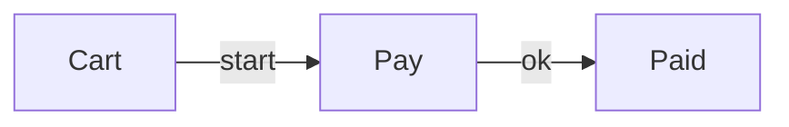

# Spec format

Version 1.1. Status: proposed, waiting for approval before the parser (T4.2) starts. 1.1 adds optional `action:` click lines (S015).

A spec describes one flow: the steps a user or system goes through, how they connect, and what must be true at each step. The format is plain Markdown so people can read and review it in a pull request, and strict enough that a parser, a diagram editor and a drift checker agree on every byte of it.

The worked example is [`fixtures/shop/spec/checkout.md`](../fixtures/shop/spec/checkout.md). The parser tests use that file, so where this document and the fixture disagree, that is a bug in one of them.

## Decisions to confirm

These are the choices the rest of the work builds on. Everything below follows from them.

1. **One file per flow, in `spec/`.** `spec/checkout.md` is the flow `checkout`. The file name is the flow id. Subfolders group flows into areas for the app map (`spec/storefront/checkout.md` is the flow `checkout` in the area `storefront`). The index reads every `spec/` folder of a repo, so `fixtures/shop/spec/checkout.md` is a spec too; a Markdown file whose name is not an id (`README.md`) is prose and is skipped.
2. **Ids are dotted paths.** A step is `checkout.failed`, a requirement is `checkout.failed/r2`. Ids are lowercase `snake_case`, never reused, and never derived from titles, so renaming a title changes nothing downstream.
3. **The Mermaid diagram and the headings both carry the step id.** The diagram uses the short id (`failed`), the heading carries the full id (`{#checkout.failed}`). They are checked against each other, so a mismatch is an error, not a guess.
4. **The Mermaid is a strict subset.** Only labelled nodes, labelled edges, `click` lines and comments. Anything else is an error. This is what lets the diagram editor write the file back without losing anything.
5. **Edge labels are required.** An edge is identified by its source, label and target, so `pay -->|declined| failed` and `pay -->|ok| paid` are different edges even from the same node.
6. **One behaviour per requirement line.** `WHEN … THE SYSTEM SHALL … . {#rN}`, exactly one WHEN and one SHALL, on one logical line. A list item that looks like a requirement but does not parse is an error, so a typo can never silently drop a requirement.
7. **The reason for a step is a `> @flow` quote in the spec.** The `@flow` comment in code is only an anchor with a short note. The spec holds the canonical reason, the code points at it.
8. **`#[spec("id")]` is the single anchor attribute, for code and tests.** On a test function it means "this test covers that requirement". On any other function it means "this code implements that step". Rust only in v1. Annotated code compiles with the no-op `spec` attribute from the [`codespec-rust-macro`](https://crates.io/crates/codespec-rust-macro) crate (MIT), the one devpage uses too. The parser reads source text and does not need it.
9. **Node positions are not in the spec.** The prototype saves a layout when you drag nodes. In the real format that belongs in a sidecar (`spec/checkout.layout.json`, written by the diagram editor), so moving a box never shows up as a spec change in review. The Mermaid layout direction (`LR`) stays in the spec.

## File layout

```
spec/checkout.md
```

A spec file has, in this order:

1. one title line: `# <Title> {#<flow>}`
2. one fenced `mermaid` block
3. one section per node in the diagram, `## <Title> {#<flow>.<node>}`

Text between the title and the diagram, and any prose in a section, is allowed and ignored by tools, except where this document says otherwise.

## Ids

```
segment   = [a-z] [a-z0-9_]*          (1 to 40 characters)
flow      = segment                   (must equal the file name without .md)
node      = segment
step id   = flow "." node             checkout.failed
tag       = "r" [1-9] [0-9]*          r1, r2, r10
req id    = step id "/" tag           checkout.failed/r2
```

- A node id is unique within its flow.
- A tag is unique within its step. Tags are never renumbered. When a requirement is deleted its tag is retired and not reused, so `r1, r3` is valid and `r2` stays gone.
- Hyphens, capitals and dots inside a segment are not allowed. This keeps ids valid as Mermaid node ids, in URLs (`spec://checkout.failed`) and in Rust string literals.

## The title

```
# Checkout {#checkout}
```

`# ` then free text, then ` {#<flow>}`. The id must equal the file name. There is exactly one H1.

## The diagram

One fenced block with the info string `mermaid`, containing a `flowchart`:



Grammar, one construct per line, blank lines allowed anywhere:

```
header  = "flowchart" SP ("LR" | "RL" | "TD" | "TB" | "BT")      first line
node    = node-id "[" label "]"
edge    = node-id SP "-->" "|" edge-label "|" SP node-id
click   = "click" SP node-id SP "href" SP '"spec://' step-id '"'
action  = "click" SP node-id SP "href" SP '"action:' name ["?" query] '"' [SP '"' tooltip '"']
comment = "%%" text
```

- `label` and `edge-label` are non-empty, trimmed, single-line text without the characters `[ ] | "`.
- A node is declared once, on its own line, before any edge uses it. Inline declarations such as `a[A] --> b[B]` are not allowed.
- The node label is the short name on the box. It does not have to equal the section title (`Declined` is the box, `Declined payment` is the section).
- `click` lines are written by the tooling so the diagram links to its section. They are optional. If present, the href must be the step id of the node it names, in this flow.
- `action` lines make a node clickable in the app through [mermaid-actions](https://github.com/xoriors/experimental/tree/main/mermaid-actions): `copy`, `toggle`, `show` and so on. They are optional and the app runs them, the parser only checks the line. `name` is `[a-z][a-z0-9-]*`, the href has no whitespace and no `"`, the tooltip is non-empty and has no `"`, and the words are separated by single spaces.
- A node has at most one `click` line, `spec://` or `action:`, because Mermaid keeps only one per node.
- Self edges (`a -->|x| a`) are allowed. Cycles are allowed (`pay` to `failed` and back is the example).
- Styles, subgraphs, other arrow types, `classDef`, `style`, `linkStyle` and any other Mermaid construct are errors, not ignored.

## Step sections

```
## Declined payment {#checkout.failed}

- WHEN a payment is declined THE SYSTEM SHALL show the reason. {#r1}
- WHEN a decline goes past the retry limit of 3 THE SYSTEM SHALL cancel the order. {#r2}

> @flow Why a retry limit? Card networks flag repeated retries as card testing.
```

- The heading is `## ` then free text, then ` {#<flow>.<node>}`. The id must be one of the diagram's nodes.
- Every node has exactly one section and every section matches a node. Section order is free and is kept as written.
- A section holds requirement lines, optional prose, and at most one `@flow` quote.

### Requirement lines

```
requirement = "- WHEN " condition " THE SYSTEM SHALL " response "." SP "{#" tag "}"
```

- `WHEN`, `THE SYSTEM SHALL` and the final `.` are case sensitive. `condition` and `response` are non-empty text. Neither contains `THE SYSTEM SHALL` or `WHEN ` as a word of its own, so there is one behaviour per line.
- A requirement may wrap onto following lines indented by two or more spaces. The parser joins them with single spaces. The writer emits one line unless it is longer than 100 characters.
- The `{#tag}` goes last. A line that continues past it is an error.
- A list item that starts with `WHEN` or contains `THE SYSTEM SHALL` and does not match this grammar is an error. This is the rule that stops silent loss. A list item with neither is ordinary prose.
- A condition or response may contain numbers and units (`14 days`, `limit of 3`). These are the values drift checking compares against code, so state them as written there.

### The `@flow` quote

```
> @flow <reason, free text>
```

A blockquote whose first line starts with `@flow `. It records why the step is the way it is. It is shown next to the step in the app and handed to agents as context. At most one per section. Its text may continue over more `>` lines.

## Anchors in code

An anchor ties code to a step or a requirement. Two forms, Rust only in v1.

```rust
#[spec("checkout.failed")]
pub fn on_declined(o: &mut Order, why: Decline) -> State {
    // @flow checkout.failed: cap retries, then cancel
    ...
}

#[test]
#[spec("checkout.failed/r2")]
fn retry_limit_is_3() { ... }
```

### `#[spec("<id>")]`

- The argument is one or more string literals, either `#[spec("a", "b")]` or several `#[spec(...)]` attributes. Each is a step id or a requirement id.
- Write one id per attribute and repeat the attribute for more. Both forms are valid here, but devpage reads only the first id of `#[spec("a", "b")]` ([Using spectrace with devpage](#using-spectrace-with-devpage)).
- It applies to the item it decorates (function, method, `impl` block, `mod`).
- **Coverage anchor.** If the item also has a test attribute (`#[test]`, `#[tokio::test]`, or any attribute ending in `::test`), the anchor says the test covers that id. A test anchored to a step id covers every requirement of that step.
- **Implementation anchor.** Otherwise it says the item implements that id.
- The parser works on the text of `.rs` files. It does not expand macros, so anchors produced by macros are not seen.

### `@flow` comments

```
// @flow <step-id>: <note>
/// @flow <step-id>: <note>
```

A line comment (`//` or `///`) containing `@flow`, a step id, a colon and a one-line note. It marks the exact spot where a step's non-obvious decision is made, and the note says what the code does there. It is not a requirement anchor and does not count as coverage. The note is not compared with the spec's `@flow` quote, which stays the source of the reason.

## Using spectrace with devpage

[devpage](https://github.com/andrei512/devpage) serves a repository's Markdown as live docs, and its [requirements check](https://github.com/andrei512/devpage/blob/main/docs/boxes/viewer/check/checking-requirements/README.md) reads the same `#[spec("<id>")]` anchors: `devpage check` fails when a constraint page has no test pointing at it, a test names an id no constraint has, or a test fails. One set of anchors serves both tools when they follow three rules.

1. **Point devpage at test files only.** devpage counts every match in a suite's `glob` as a test pointing at a constraint, and cannot tell a coverage anchor from an implementation anchor. Give it the folders that hold only tests (`tests/**/*.rs`), never `src/`, or each implementation anchor there counts as a test.
2. **Tests name requirement ids.** devpage's constraints are requirements, so a test anchored to a step id (`checkout.failed`) is reported there as `no constraint has this id`. Anchor tests to `checkout.failed/r2`; steps stay for implementation anchors.
3. **One id per `#[spec]`.** devpage's pattern takes one id per match.

devpage accepts any string as an id, so spectrace's ids work unchanged. The suite for a site's `devpage.yml`, as in [`fixtures/shop/devpage-requirements.yml`](../fixtures/shop/devpage-requirements.yml):

```yaml
extensions:
  requirements:
    config:
      tests:
        - name: rust
          glob: "../tests/**/*.rs"   # relative to the devpage.yml
          pattern: '#\[spec\("([^"]+)"\)\]'
          run: "cargo +nightly test -- -Z unstable-options --format junit"
```

`crates/core/tests/devpage_anchors.rs` applies that suite to `fixtures/shop` the way devpage does and checks it finds exactly the coverage anchors the scanner finds. devpage also needs a constraint page per requirement (`page-type: constraint`, `id: <requirement id>`); spectrace does not write those yet.

## What is an error

Parsing a spec gives a list of diagnostics, each with a code, a file, a line and a message. Any error makes the spec unusable and blocks the tools that read it. Warnings are shown but never block.

### Errors in a spec file

| Code | Condition |
|---|---|
| `S001` | No title line, more than one H1, or the title id is missing or does not match the file name |
| `S002` | No `mermaid` block, or more than one |
| `S003` | The block is not a `flowchart`, or the direction is not one of `LR RL TD TB BT` |
| `S004` | A diagram line is not a node, labelled edge, `click` (`spec://` or `action:` form) or comment |
| `S005` | An edge has no label, an empty label or an unlabelled arrow |
| `S006` | An id breaks the id grammar, or a node is declared twice |
| `S007` | An edge or `click` (either form) names an undeclared node |
| `S008` | A node has no section, or a section's id is not a node |
| `S009` | A section id repeats, or its flow part is not this flow |
| `S010` | A list item looks like a requirement but does not parse |
| `S011` | A tag repeats within a step, or is not `r` followed by a positive integer |
| `S012` | A section has more than one `@flow` quote |
| `S013` | A `click` href does not match the node it is on |
| `S014` | Two identical edges (same source, label and target) |
| `S015` | A node has more than one `click` line |

### Warnings in a spec file

| Code | Condition |
|---|---|
| `W001` | A step has no requirement lines |
| `W002` | A node has no edges at all |
| `W003` | A requirement line is over 100 characters on one line |

### Errors against code

These come from checking anchors against the parsed specs, not from the spec file alone.

| Code | Condition |
|---|---|
| `A001` | An anchor or `@flow` comment names an id that does not exist |
| `A002` | A `#[spec(...)]` has an argument that is not a string literal or is not a valid id |
| `A003` | A `@flow` comment has no id or no colon |

A requirement with no test anchored to it is not an error. That is coverage, reported by the coverage view and not by the parser. A step with no implementation anchor is likewise reported, not rejected.

## What the writer promises

The diagram editor and agents change specs through one writer, not by editing text. For any valid spec the writer reads, changes and writes back, it must:

- keep every id, tag, section, prose paragraph and `@flow` quote it was not asked to change, byte for byte;
- keep section order and the order of nodes, edges and `click` lines;
- add new nodes, edges and sections at the end of their block;
- never reuse a retired tag;
- produce output that parses with no errors.

A round trip of every file in `fixtures/shop` through parse and write must give the same bytes. T4.2 and T4.3 test that.

## Changing the format

The format is versioned by this document. A change that makes a valid spec invalid, or the reverse, bumps the version at the top and is announced in the pull request.
