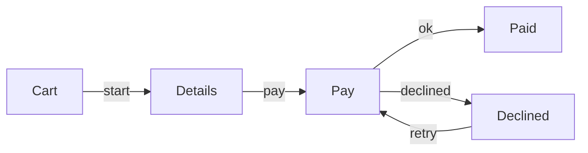

# Checkout {#checkout}

## Cart {#checkout.cart}

- WHEN the cart is empty THE SYSTEM SHALL disable the checkout button. {#r1}
- WHEN an item is out of stock THE SYSTEM SHALL mark it and keep the rest. {#r2}

> @flow Stock is checked again at checkout because the catalog cache can be up to a minute old.

## Details {#checkout.details}

- WHEN the address is invalid THE SYSTEM SHALL show which field is wrong. {#r1}
- WHEN the user is signed in THE SYSTEM SHALL prefill their saved details. {#r2}

> @flow Prefill from the account, but never from a previous guest order on a shared device.

## Pay {#checkout.pay}

- WHEN the user pays THE SYSTEM SHALL charge the card exactly once. {#r1}
- WHEN the gateway times out THE SYSTEM SHALL retry with the same idempotency key. {#r2}

> @flow An idempotency key per order stops a gateway timeout from charging twice.

## Declined payment {#checkout.failed}

- WHEN a payment is declined THE SYSTEM SHALL show the reason. {#r1}
- WHEN a decline goes past the retry limit of 3 THE SYSTEM SHALL cancel the order. {#r2}

> @flow Why a retry limit? Card networks flag repeated retries as card testing.

## Paid {#checkout.paid}

- WHEN payment succeeds THE SYSTEM SHALL email a receipt. {#r1}

> @flow The receipt is sent from the outbox so a crash after payment never loses it.
